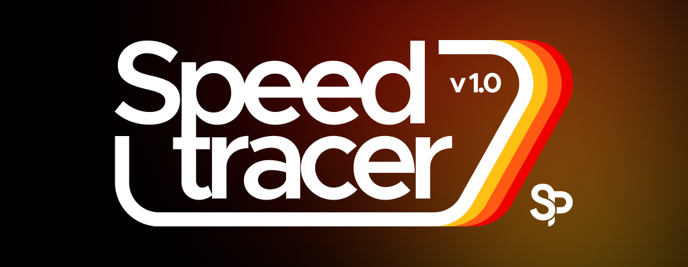

<p align="center">
  
</p>

# SpeedTracer 🚴‍♂️💨
### Sunlight Cycling Navigation Computer

[](https://platformio.org/)
[](https://www.arduino.cc/)
[](https://www.schematik.io/projects/sunlight-cycling-navigation-computer-gcek)
[](LICENSE)

SpeedTracer (derived from the [Sunlight Cycling Navigation Computer on Schematik.io](https://www.schematik.io/projects/sunlight-cycling-navigation-computer-gcek)) is an open-source, DIY GPS bike computer inspired by the Garmin Edge, Wahoo ELEMNT, and Magene C606.

Built around the high-performance **ESP32-S3** microcontroller and a **2.8-inch IPS color display**, SpeedTracer features a **high-contrast, sunlight-readable UI** (crisp black-on-white graphics with vivid navigation accents) designed specifically for legibility under bright outdoor daylight.

---

## 📸 Key Features

* **🏎️ Speed Dial & Multi-Screen Dashboard**:
  * Smooth animated speed arc dial with live km/h readout, average speed, and max speed.
  * Distance covered (km), elapsed ride time (`hh:mm:ss`), and grade % (slope).
  * **3 Full Screen Modes**:
    1. **Dashboard View**: Hero speed arc dial, ride time, distance, heart rate card, cadence, grade %, satellites, calories.
    2. **Map & Breadcrumbs View**: Real-time course tracking with user pinned at center (`120, 137`), heading direction triangle, route line, and 5-level zoom.
    3. **Dedicated Metrics View**: Grid view of Ambient Temp, Heart Rate (BPM), Power (Watts), Calories, Speed, Cadence, Direct Distance, and Elevation.
  * **Light & Dark Theme Engine**: High-contrast sunlight-readable daylight theme + battery-saving dark mode.
* **👆 Capacitive Touch Screen & Quick Settings**:
  * Integrated **CST3530** capacitive touch driver (SDA 1, SCL 3, INT 4, RST 2).
  * Tap top header bar anytime to pull down the **Quick Settings Overlay**:
    * Outdoor cycling recording card with **Pause / Resume** toggle.
    * 6 interactive tiles: Wi-Fi Hotspot, Bluetooth Sensors, GPS Fix, Theme Switcher, Hardware Diagnostics, and Phone Config.
  * Tap bottom bar (`y >= 290`) to cycle through screens (Dashboard ➔ Map ➔ Metrics).
  * Tap bottom half in Map view to zoom in/out (`+` / `-`).
* **📡 Bluetooth Low Energy (BLE) Cycling Sensors**:
  * Native background Bluetooth scanning and pairing via `NimBLE-Arduino`.
  * Supports standard Bluetooth SIG profiles:
    * **Heart Rate Monitors (HRM)** (Service `0x180D`, Characteristic `0x2A37`).
    * **Cycling Speed & Cadence (CSC)** (Service `0x1816`, Characteristic `0x2A5B`).
    * **Cycling Power Meters** (Service `0x1818`, Characteristic `0x2A63`).
  * Auto-reconnects to up to 3 saved sensors with NVS persistence and link-loss recovery.
* **🗺️ Breadcrumb Mapping & Navigation**:
  * Real-time GPS coordinate plotting with your location pinned at center (`120, 137`).
  * Dynamic compass heading indicator (direction triangle) driven by the QMC5883L 3-axis magnetometer.
  * Planned route lines (orange) and breadcrumb history (teal) with screen boundary clipping.
  * Direct line-of-sight distance, bearing, and estimated time of arrival (ETA).
* **🛰️ Multi-Constellation GNSS**:
  * **GEPRC GEP-M1025Q** u-blox M10 GPS receiver on dedicated UART (RX 44, TX 43).
  * Binary **UBX NAV-PVT** parsing with pDOP filtering for low-latency positioning and automatic NMEA fallback.
* **📱 Embedded Web Companion App**:
  * Built-in WiFi Access Point (`CycloComp` / password: `cycling1234`).
  * Web dashboard at `http://192.168.4.1` with:
    * Live telemetry and sensor health monitoring.
    * **Bluetooth Manager**: One-click sensor scanning, pairing, and slot management.
    * **Display Remote**: Switch screens (Dashboard, Metrics, Map), toggle Quick Settings, switch Light/Dark theme.
    * Destination coordinate input and 512-point route JSON upload.
    * Configuration editor for gear ratio, wheel circumference, rider/bike mass.
    * Compass calibration controls (`start`, `finish`, `alignment`).
    * Full CSV ride log download and GPX 1.1 preview export.
* **💾 Ride Logging**:
  * Logs to MicroSD `/ride.csv` every 3s while moving, tagging telemetry sources (`BLE`, `bridge`, `GPS_or_bridge`, `estimate`).

---

## 🛠️ Hardware Stack & Phased Roadmap

### Phase 1: Core Telemetry & GPS Mapping (Current Active Build)
* [x] **SoC & Screen**: [Waveshare ESP32-S3-Touch-LCD-2.8](https://www.waveshare.com/esp32-s3-touch-lcd-2.8.htm) (240×320 IPS display, ST7789V2 via FSPI).
* [x] **GPS & Compass**: [GEPRC GEP-M1025Q](https://geprc.com/product/geprc-gep-m1025-gps-module/) (u-blox M10 GNSS + QMC5883L magnetometer).
* [x] **Power**: USB Type-C connection to any portable powerbank.
* [x] **Controls**: Onboard **BOOT key (GPIO 0)** for screen toggling and map zooming + Web App remote control.

### Phase 2: MicroSD Offline Maps & GPX Navigation
* [ ] 16GB FAT32 MicroSD card inserted into the board's onboard TF slot (HSPI).
* [ ] Turn-by-turn navigation cues and offline vector map rendering.

### Phase 3: Physical Remote Buttons & Barometer
* [ ] **Adafruit MCP23017** 16-channel I2C GPIO expander at address `0x20`.
* [ ] 4 momentary handlebar buttons (UP, DOWN, LEFT, RIGHT).
* [ ] **Adafruit BMP390** precision barometric pressure sensor (STEMMA QT) at address `0x77`.
* [ ] 3.7V 1200mAh protected Li-ion pouch battery plugged into the board's MX1.25 battery header with active power latching (`SYS_EN` on GPIO 7).

---

## 🔌 Wiring & Pinout Guide

### Phase 1: GEPRC GEP-M1025Q GPS + Compass Connection

Connect the **GEPRC GEP-M1025Q** module to the Waveshare development board's **12-pin multi-functional connector** using the **3V3 rail**:

```
+-----------------------------------+        +-----------------------------------+
|      GEPRC GEP-M1025Q GPS         |        |   Waveshare ESP32-S3 12-Pin Port  |
|                                   |        |                                   |
|   [VCC]  -----------------------> | -----> |   3V3 (3.3V Power Rail)           |
|   [GND]  -----------------------> | -----> |   GND (Pin 1 or 5)                |
|   [TX]   -----------------------> | -----> |   GPIO 44 (Board RXD / Pin 10)    |
|   [RX]   <----------------------- | <----- |   GPIO 43 (Board TXD / Pin 9)     |
|   [SDA]  <----------------------> | <----> |   GPIO 11 (I2C SDA / Pin 8)       |
|   [SCL]  -----------------------> | -----> |   GPIO 10 (I2C SCL / Pin 7)       |
+-----------------------------------+        +-----------------------------------+
```

> [!IMPORTANT]
> * **Power**: Connect VCC to the **3V3** rail (not 5V VBUS).
> * **UART**: Ensure GPS **TX** connects to ESP32 **RX (GPIO 44)**, and GPS **RX** connects to ESP32 **TX (GPIO 43)**.
> * **Shared I²C Bus**: **GPIO 11 (SDA)** and **GPIO 10 (SCL)** are shared across the QMC5883L compass (`0x0D`), Waveshare BMP390 (`0x77`/`0x76`), and Adafruit MCP23017 (`0x20`).

For the complete project I/O mapping across all phases (including internal LCD FSPI, CST3530 Touch I2C bus 1, HSPI microSD, and MCP23017 GPA0–GPA3 buttons), see [hardware/pinouts/pin_reservation.md](hardware/pinouts/pin_reservation.md).

---

## 🚀 Quickstart & Flashing Guide

Choose one of two ways to flash your device:

### Option A: Instant Flash with Precompiled Binaries (No toolchain required)

Precompiled binaries exported from Schematik.io are provided in `firmware/bin/`:

#### On Windows:
1. Connect your Waveshare ESP32-S3 board to your PC via USB Type-C.
2. Open `firmware/bin/` and double-click **`flash.bat`**.
3. Enter your serial COM port (e.g. `COM3` or `COM4`) and press Enter.

#### On Linux / macOS:
```bash
cd firmware/bin
chmod +x flash.sh
./flash.sh /dev/ttyACM0
```

#### Manual `esptool.py` Command:
```bash
python -m esptool --chip esp32s3 -b 921600 write_flash -z \
  0x0 firmware/bin/bootloader.bin \
  0x8000 firmware/bin/partitions.bin \
  0xe000 firmware/bin/boot_app0.bin \
  0x10000 firmware/bin/firmware.bin
```

---

### Option B: Build and Flash from Source with PlatformIO

1. Install [VS Code](https://code.visualstudio.com/) and the [PlatformIO IDE extension](https://platformio.org/).
2. Clone this repository:
   ```bash
   git clone https://github.com/<your-username>/SpeedTracerProject.git
   cd SpeedTracerProject/firmware
   ```
3. Build the firmware:
   ```bash
   pio run -e esp32-s3-devkitc-1
   ```
4. Flash to your board:
   ```bash
   pio run -e esp32-s3-devkitc-1 -t upload
   ```
5. Open the serial monitor:
   ```bash
   pio device monitor -e esp32-s3-devkitc-1
   ```

---

## 🚲 Outdoor Testing Guide (Phase 1)

1. **Powering On**:
   * Plug your board into a 5V USB Type-C powerbank.
   * The display will boot, showing the **SpeedTracer V2** splash screen with WiFi credentials.
2. **Satellite Fix**:
   * Take the rig outdoors under open sky.
   * The status bar changes from `WAITING FOR GPS` to `GPS LIVE` once valid u-blox NAV-PVT satellite locks are achieved.
3. **Screen Controls (Without Extra Buttons)**:
   * **Short press the onboard BOOT button (GPIO 0)** to switch between the **Dashboard** and **Map** screens.
   * **Hold the onboard BOOT button (> 700ms)** while in the Map view to cycle through zoom levels (`Z1` through `Z5`).
4. **Connecting to the Web App**:
   * On your phone, connect to the WiFi network:
     * **SSID**: `CycloComp`
     * **Password**: `cycling1234`
   * Open your mobile browser and navigate to:
     ```
     http://192.168.4.1
     ```
   * From the web page, you can set target coordinates, upload JSON routes, inspect live telemetry, or trigger compass calibration.
5. **Calibrating the Compass**:
   * Send a POST request to `/compass` with `{"action":"start"}` (or via the web portal).
   * Rotate the entire device level through 2-3 full 360° circles.
   * Send `{"action":"finish"}` to calculate offsets and save them to NVS flash.

---

## 📂 Repository Structure

```
SpeedTracerProject/
├── firmware/
│   ├── bin/                        # Precompiled binaries and one-click flash scripts
│   │   ├── bootloader.bin
│   │   ├── partitions.bin
│   │   ├── boot_app0.bin
│   │   ├── firmware.bin
│   │   ├── flash.bat               # Windows one-click flash
│   │   └── flash.sh                # Linux/macOS flash script
│   ├── include/
│   │   ├── config/pin_config.hpp   # Verified pin mappings
│   │   ├── Drivers/geprc.h         # UBX NAV-PVT & QMC5883L compass driver
│   │   ├── models/                 # RideData, Config, NavState data structs
│   │   ├── services/               # Display, GPS, Input, Storage, Web services
│   │   └── ui/                     # Dashboard, Map, and Splash screen renderers
│   ├── src/                        # Modular C++ implementation
│   │   ├── main.cpp                # Arduino setup() and loop() entry
│   │   ├── App.cpp                 # System lifecycle & event loop
│   │   ├── services/
│   │   └── ui/
│   ├── standalone/firmware.cpp     # Reference single-file implementation
│   └── platformio.ini              # PlatformIO project configuration
├── hardware/
│   └── pinouts/pin_reservation.md  # Detailed connector and pin table
├── enclosure/                      # 3D printable CAD models and STL cases
└── docs/
    └── architecture/               # System architecture documentation
```

---

## 🤝 Contributing

Contributions are warmly welcome! Whether you are designing a 3D-printable bike mount enclosure, adding BLE heart-rate/cadence sensor support, or improving map tile rendering, feel free to open an issue or pull request.

## 📄 License

This project is licensed under the [MIT License](LICENSE).
